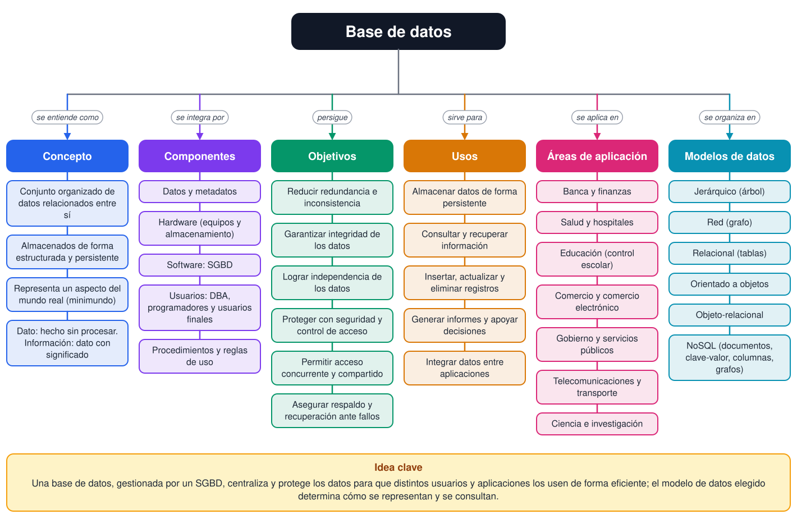
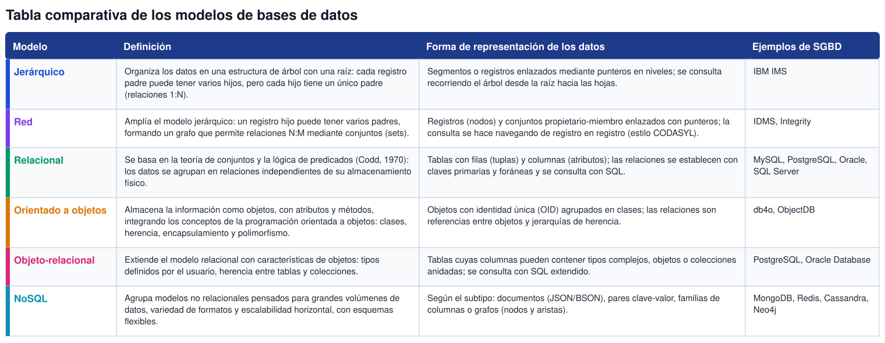

# Tarea 1.1: Fundamentos, objetivos y modelos de bases de datos

**Unidad 1:** Introducción a las bases de datos  
**Materia:** Fundamentos de Base de Datos  
**Alumno(a):** Kevin Anselmo Orozco Aguayo (matrícula I24050540)  
**Docente:** Rubén Riojas  
**Fecha de entrega:** 03 de noviembre de 2026

---

## Introducción

Las bases de datos son el fundamento de casi cualquier sistema de información actual: desde el registro de calificaciones de una escuela hasta las transacciones de un banco o el catálogo de una tienda en línea. Comprender qué es una base de datos, para qué sirve y de qué maneras puede organizarse la información es el punto de partida para proponer soluciones en el tratamiento de datos, que es la competencia específica de esta unidad.

Este documento presenta una investigación sobre los conceptos fundamentales, los objetivos, los usos y las áreas de aplicación de las bases de datos; un mapa conceptual analítico que integra estos temas; y una tabla comparativa de los principales modelos de bases de datos (jerárquico, red, relacional, orientado a objetos, objeto-relacional y NoSQL), donde se detalla su definición y la forma en que representan los datos.

## 1. Conceptos fundamentales

### 1.1 Dato e información

Un dato es un hecho o valor registrado que, por sí solo, tiene un significado limitado (por ejemplo, el número 9.5 o el nombre “Ana”). La información es el resultado de organizar e interpretar los datos dentro de un contexto, de modo que sirvan para comprender una situación o tomar decisiones (Coronel & Morris, 2019).

### 1.2 Base de datos

Una base de datos es una colección de datos relacionados entre sí que representa algún aspecto del mundo real y que se diseña, construye y llena con un propósito específico para un grupo de usuarios (Elmasri & Navathe, 2016). Entre sus características principales se encuentran:

- **Persistencia:** los datos se conservan de forma duradera, aunque se apague el equipo o termine la aplicación.
- **Estructura:** los datos se organizan de acuerdo con un modelo de datos (por ejemplo, tablas relacionadas).
- **Autodescripción:** además de los datos, almacena su propia descripción (catálogo o metadatos).
- **Independencia de los datos:** los programas no dependen de cómo se almacenan físicamente los datos.
- **Compartición:** varios usuarios y aplicaciones pueden usar la misma información, incluso de forma simultánea.
- **Integridad y consistencia:** se aplican reglas (restricciones) para que los datos sean correctos y coherentes.

### 1.3 Sistema gestor de bases de datos (SGBD)

Un sistema gestor de bases de datos (SGBD) es el software que permite crear, definir, mantener y controlar el acceso a una base de datos; actúa como intermediario entre los usuarios o las aplicaciones y los datos almacenados (Date, 2004; Silberschatz et al., 2020). Sus funciones principales son la definición de la estructura de los datos, su manipulación (insertar, consultar, modificar y eliminar), el control de acceso y seguridad, el control de concurrencia, la recuperación ante fallos y el mantenimiento de la integridad. El conjunto formado por la base de datos, el SGBD y las aplicaciones que los utilizan se denomina sistema de bases de datos.

### 1.4 Componentes de un sistema de bases de datos

- **Datos:** la información almacenada, junto con sus metadatos.
- **Hardware:** computadoras, servidores y dispositivos de almacenamiento.
- **Software:** el SGBD, el sistema operativo y las aplicaciones.
- **Usuarios:** administrador de la base de datos (DBA), diseñadores, programadores y usuarios finales.
- **Procedimientos:** reglas e instrucciones para el diseño, uso, respaldo y mantenimiento (Coronel & Morris, 2019).

### 1.5 Esquema e instancia

El esquema es la descripción de la estructura de la base de datos (tablas, atributos, relaciones y restricciones) y cambia poco con el tiempo. La instancia (o estado) es el conjunto de datos almacenados en un momento determinado, que cambia constantemente con cada operación (Elmasri & Navathe, 2016).

## 2. Objetivos de las bases de datos

Antes de las bases de datos, muchas organizaciones guardaban su información en archivos independientes para cada aplicación, lo cual generaba duplicación, inconsistencias y dificultad para consultar o proteger los datos (Silberschatz et al., 2020). Los objetivos de las bases de datos responden directamente a esos problemas:

- **Reducir la redundancia y la inconsistencia:** evitar que el mismo dato se repita en varios lugares con valores distintos.
- **Garantizar la integridad:** asegurar que los datos cumplan reglas de validez (claves, tipos de dato, restricciones).
- **Lograr independencia de los datos:** permitir cambios en el almacenamiento o en la estructura sin reescribir las aplicaciones.
- **Facilitar el acceso eficiente:** ofrecer lenguajes de consulta, como SQL, para obtener la información necesaria con rapidez.
- **Proteger la información:** controlar quién puede ver o modificar cada dato mediante autenticación y privilegios.
- **Permitir el acceso concurrente y compartido:** que muchos usuarios trabajen a la vez sin interferirse, mediante transacciones.
- **Asegurar el respaldo y la recuperación:** restaurar los datos de manera consistente después de un fallo.

## 3. Usos de las bases de datos

En términos generales, una base de datos se utiliza para:

- Almacenar de forma persistente y organizada grandes cantidades de datos.
- Consultar y recuperar información específica de manera rápida y flexible.
- Insertar, actualizar y eliminar registros manteniendo la consistencia.
- Generar informes, estadísticas y tableros que apoyan la toma de decisiones.
- Integrar y compartir datos entre distintas aplicaciones y áreas de una organización.
- Controlar el acceso a la información sensible y llevar un registro de las operaciones.

## 4. Áreas de aplicación

Las bases de datos se encuentran en prácticamente todos los sectores. Algunas aplicaciones típicas son las empresariales, bancarias, universitarias, de telecomunicaciones y de servicios web (Silberschatz et al., 2020):

- **Banca y finanzas:** cuentas, transacciones, préstamos y detección de fraudes.
- **Salud:** expedientes clínicos, citas, inventario de medicamentos y facturación.
- **Educación:** control escolar, calificaciones, inscripciones y plataformas de aprendizaje.
- **Comercio y comercio electrónico:** catálogos, inventarios, pedidos, clientes y recomendaciones.
- **Gobierno y servicios públicos:** padrones, trámites, registros civiles y fiscales.
- **Telecomunicaciones y transporte:** facturación, reservaciones, rutas y horarios.
- **Ciencia e investigación:** datos genómicos, mediciones de sensores y observaciones astronómicas.
- **Redes sociales y web:** perfiles, publicaciones y relaciones entre usuarios.

## 5. Mapa conceptual analítico

La Figura 1 integra los conceptos de las secciones anteriores. En el centro se ubica la base de datos y de ella parten seis ramas, unidas por frases de enlace: qué es (concepto), de qué se compone, qué objetivos persigue, para qué sirve, en qué áreas se aplica y mediante qué modelos de datos se organiza. La lectura analítica es la siguiente: el SGBD, como parte del software, es el elemento que hace posibles los objetivos (integridad, seguridad, concurrencia y recuperación); estos objetivos justifican los usos y las áreas de aplicación; y el modelo de datos elegido determina cómo se representan, relacionan y consultan los datos.

*Figura 1. Mapa conceptual analítico de las bases de datos. Elaboración propia.*

## 6. Modelos de bases de datos

Un modelo de datos es un conjunto de conceptos que permite describir la estructura de una base de datos: los tipos de datos, las relaciones entre ellos y las restricciones que deben cumplir (Elmasri & Navathe, 2016). A continuación se resumen los principales modelos; la Tabla 1 los compara en cuanto a su definición y forma de representar los datos.

### 6.1 Modelo jerárquico

Surgió en la década de 1960 y fue popularizado por el sistema IMS de IBM. Es muy eficiente cuando los datos tienen una estructura natural de árbol, pero es rígido: representar relaciones N:M obliga a duplicar información (Date, 2004).

### 6.2 Modelo de red

Fue estandarizado por el grupo CODASYL. Resuelve la limitación del modelo jerárquico al permitir varios padres por registro, aunque los programas deben navegar manualmente por los enlaces, lo que hace más compleja su programación y mantenimiento (Date, 2004; Silberschatz et al., 2020).

### 6.3 Modelo relacional

Propuesto por Codd (1970), separa la estructura lógica de los datos de su almacenamiento físico y representa todo mediante relaciones (tablas). Su base matemática, la normalización y el lenguaje SQL lo convirtieron en el modelo predominante en los sistemas comerciales (Elmasri & Navathe, 2016).

### 6.4 Modelo orientado a objetos

Nació para manejar datos complejos (diseño asistido por computadora, multimedia) y para evitar la diferencia de representación entre los objetos de los lenguajes de programación y las tablas de las bases relacionales. Guarda directamente objetos con su estado y su comportamiento (Elmasri & Navathe, 2016).

### 6.5 Modelo objeto-relacional

Combina la solidez del modelo relacional con funciones de objetos, como tipos definidos por el usuario y herencia. Varios SGBD relacionales actuales incorporan estas extensiones (Silberschatz et al., 2020).

### 6.6 Modelos NoSQL

Aparecieron para atender aplicaciones web con enormes volúmenes de datos y necesidad de escalar horizontalmente. Incluyen bases de datos de documentos, clave-valor, columnas y grafos, y suelen ofrecer esquemas flexibles a cambio de relajar algunas garantías transaccionales (Sadalage & Fowler, 2012).

*Tabla 1. Comparación de los modelos de bases de datos. Elaboración propia.*

| Modelo | Definición | Forma de representación de los datos | Ejemplos |
|---|---|---|---|
| **Jerárquico** | Organiza los datos en una estructura de árbol con una raíz: cada registro padre puede tener varios hijos, pero cada hijo tiene un único padre (relaciones 1:N). | Segmentos o registros enlazados mediante punteros en niveles; se consulta recorriendo el árbol desde la raíz hacia las hojas. | IBM IMS |
| **Red** | Amplía el modelo jerárquico: un registro hijo puede tener varios padres, formando un grafo que permite relaciones N:M mediante conjuntos (sets). | Registros (nodos) y conjuntos propietario-miembro enlazados con punteros; la consulta se hace navegando de registro en registro (estilo CODASYL). | IDMS, Integrity |
| **Relacional** | Se basa en la teoría de conjuntos y la lógica de predicados (Codd, 1970): los datos se agrupan en relaciones independientes de su almacenamiento físico. | Tablas con filas (tuplas) y columnas (atributos); las relaciones se establecen con claves primarias y foráneas y se consulta con SQL. | MySQL, PostgreSQL, Oracle, SQL Server |
| **Orientado a objetos** | Almacena la información como objetos, con atributos y métodos, integrando los conceptos de la programación orientada a objetos: clases, herencia, encapsulamiento y polimorfismo. | Objetos con identidad única (OID) agrupados en clases; las relaciones son referencias entre objetos y jerarquías de herencia. | db4o, ObjectDB |
| **Objeto-relacional** | Extiende el modelo relacional con características de objetos: tipos definidos por el usuario, herencia entre tablas y colecciones. | Tablas cuyas columnas pueden contener tipos complejos, objetos o colecciones anidadas; se consulta con SQL extendido. | PostgreSQL, Oracle Database |
| **NoSQL** | Agrupa modelos no relacionales pensados para grandes volúmenes de datos, variedad de formatos y escalabilidad horizontal, con esquemas flexibles. | Según el subtipo: documentos (JSON/BSON), pares clave-valor, familias de columnas o grafos (nodos y aristas). | MongoDB, Redis, Cassandra, Neo4j |

## 7. Conclusiones

Una base de datos es mucho más que un conjunto de archivos: es una colección organizada y compartida de datos que, gestionada por un SGBD, garantiza integridad, seguridad y acceso eficiente para múltiples usuarios. Sus objetivos surgieron para resolver los problemas de los sistemas basados en archivos y hoy sustentan áreas tan distintas como la banca, la salud, la educación y el comercio electrónico.

El estudio de los modelos muestra una evolución: del árbol rígido del modelo jerárquico y el grafo del modelo de red, hasta la simplicidad y base matemática del modelo relacional, y de ahí a los modelos orientados a objetos y NoSQL, que responden a datos más complejos y a mayores volúmenes. No existe un modelo mejor en todos los casos; la elección depende de la estructura de los datos, de las consultas necesarias y de los requisitos de consistencia y escalabilidad de cada proyecto.

## Referencias

Codd, E. F. (1970). A relational model of data for large shared data banks. *Communications of the ACM, 13*(6), 377–387. https://doi.org/10.1145/362384.362685  
Coronel, C., & Morris, S. (2019). *Database systems: Design, implementation, & management* (13.ª ed.). Cengage Learning.  
Date, C. J. (2004). *An introduction to database systems* (8.ª ed.). Pearson Education.  
Elmasri, R., & Navathe, S. B. (2016). *Fundamentals of database systems* (7.ª ed.). Pearson.  
Sadalage, P. J., & Fowler, M. (2012). *NoSQL distilled: A brief guide to the emerging world of polyglot persistence*. Addison-Wesley.  
Silberschatz, A., Korth, H. F., & Sudarshan, S. (2020). *Database system concepts* (7.ª ed.). McGraw-Hill Education.  
