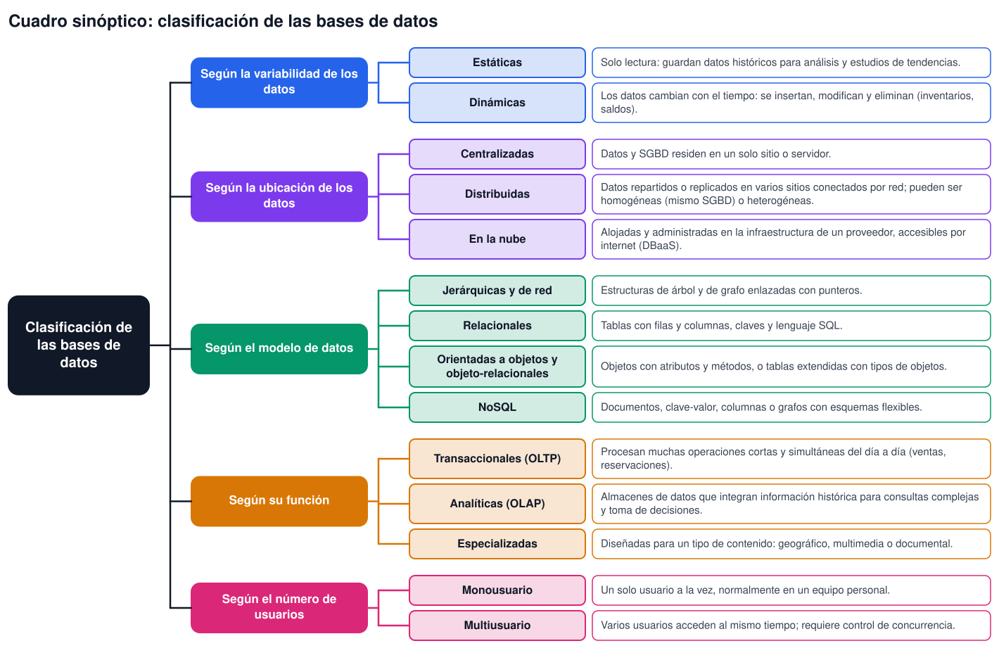
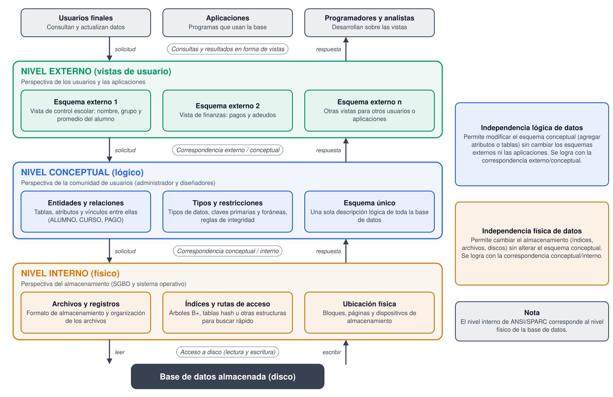
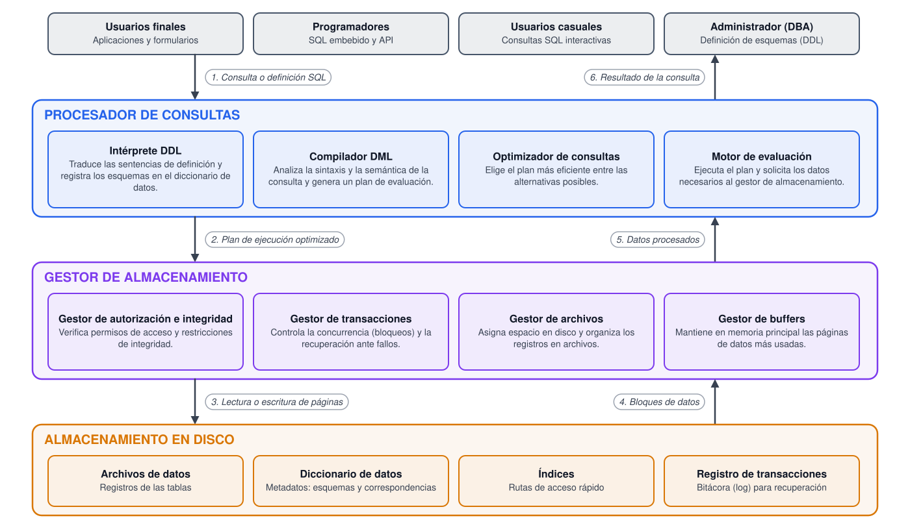

# Tarea 1.2: Clasificación y arquitecturas (ANSI/SPARC y SGBD)

**Unidad 1:** Introducción a las bases de datos  
**Materia:** Fundamentos de Base de Datos  
**Alumno(a):** Kevin Anselmo Orozco Aguayo (matrícula I24050540)  
**Docente:** Rubén Riojas  
**Fecha de entrega:** 03 de noviembre de 2026

---

## Introducción

Las bases de datos pueden agruparse de muchas maneras según el criterio que se utilice: la variabilidad de sus datos, el lugar donde se almacenan, el modelo de datos, su función o la cantidad de usuarios que las emplean. Conocer esta clasificación ayuda a elegir el tipo de base de datos más adecuado para cada problema.

Por otra parte, para que una base de datos pueda ser utilizada por muchas personas y aplicaciones sin que un cambio en un aspecto afecte a los demás, los sistemas se organizan en niveles de abstracción (arquitectura ANSI/SPARC) y el sistema gestor de bases de datos (SGBD) se compone de módulos internos con funciones específicas. Este documento presenta un cuadro sinóptico de la clasificación de las bases de datos, describe y esquematiza la arquitectura de tres niveles y explica la arquitectura funcional interna del SGBD.

## 1. Clasificación de las bases de datos

No existe una clasificación única. Los textos de la materia agrupan las bases de datos y los SGBD según distintos criterios, como el modelo de datos, el número de usuarios, el número de sitios en que se distribuye la base de datos y su propósito (Elmasri & Navathe, 2016). El cuadro sinóptico de la Figura 1 resume los cinco criterios que se abordan en este trabajo.

### 1.1 Según la variabilidad de los datos

- **Estáticas:** son bases de datos de solo lectura, que guardan datos históricos que no se modifican. Se usan para analizar información pasada y estudiar tendencias.
- **Dinámicas:** sus datos se actualizan de forma constante mediante operaciones de inserción, modificación y eliminación, como los saldos de una cuenta o el inventario de una tienda.

### 1.2 Según la ubicación de los datos

- **Centralizadas:** los datos y el SGBD residen en un solo sitio o servidor.
- **Distribuidas:** los datos se reparten o replican en varios sitios conectados por una red, pero se presentan al usuario como una sola base de datos. Pueden ser homogéneas, si todos los sitios usan el mismo SGBD, o heterogéneas, si usan SGBD distintos (Özsu & Valduriez, 2020).
- **En la nube:** están alojadas y administradas en la infraestructura de un proveedor y se accede a ellas por internet, normalmente como un servicio (DBaaS).

### 1.3 Según el modelo de datos

Se clasifican en jerárquicas, de red, relacionales, orientadas a objetos, objeto-relacionales y NoSQL. Cada modelo define cómo se representan y relacionan los datos y fue comparado en la Tarea 1.1 (Elmasri & Navathe, 2016).

### 1.4 Según su función

- **Transaccionales (OLTP):** atienden muchas operaciones cortas y simultáneas del trabajo diario, como ventas, reservaciones o pagos.
- **Analíticas (OLAP) o almacenes de datos:** integran información histórica de varias fuentes para realizar consultas complejas y apoyar la toma de decisiones (Coronel & Morris, 2019).
- **Especializadas:** se diseñan para un tipo de contenido particular, como datos geográficos, multimedia o documentales.

### 1.5 Según el número de usuarios

- **Monousuario:** solo un usuario puede utilizarla a la vez, normalmente en una computadora personal.
- **Multiusuario:** varios usuarios acceden a la vez, por lo que el SGBD debe controlar la concurrencia (Elmasri & Navathe, 2016).

*Figura 1. Cuadro sinóptico de la clasificación de las bases de datos. Elaboración propia.*

## 2. Arquitectura de tres niveles (ANSI/SPARC)

### 2.1 Origen y objetivo

La arquitectura de tres niveles fue propuesta por el grupo de estudio ANSI/X3/SPARC en la década de 1970 (Tsichritzis & Klug, 1978). Su objetivo principal es la independencia de los datos: separar la forma en que los usuarios ven la información, la manera en que está definida lógicamente y la forma en que se almacena físicamente (Date, 2004; Elmasri & Navathe, 2016).

### 2.2 Nivel externo (de vistas)

Es el nivel más cercano a los usuarios. Describe, mediante esquemas externos o vistas, la parte de la base de datos que interesa a cada grupo de usuarios o aplicaciones y oculta el resto. Por ejemplo, el área de control escolar puede ver los datos de los alumnos sin tener acceso a los datos de nómina.

### 2.3 Nivel conceptual (lógico)

Describe la estructura de toda la base de datos para la comunidad de usuarios: entidades, atributos, relaciones, tipos de datos y restricciones de integridad. Oculta los detalles de almacenamiento y es responsabilidad principal del administrador y de los diseñadores. Existe un solo esquema conceptual por base de datos.

### 2.4 Nivel interno (físico)

Describe cómo se almacenan realmente los datos: archivos, formato de los registros, índices, rutas de acceso, compresión y ubicación en disco. Lo gestiona el SGBD en coordinación con el sistema operativo. En el estándar ANSI/SPARC este nivel se denomina interno y corresponde al nivel físico.

### 2.5 Correspondencias e independencia de los datos

Los niveles se comunican mediante correspondencias (*mappings*) que el SGBD mantiene: la correspondencia externo/conceptual y la correspondencia conceptual/interno. Gracias a ellas se obtienen dos tipos de independencia (Date, 2004):

- **Independencia lógica:** se puede cambiar el esquema conceptual, por ejemplo agregando un atributo a una tabla, sin modificar los esquemas externos ni las aplicaciones.
- **Independencia física:** se puede cambiar el almacenamiento, por ejemplo creando un índice o moviendo los archivos a otro disco, sin alterar el esquema conceptual.

### 2.6 Flujo de datos entre los niveles

Como ejemplo ilustrativo, un usuario de control escolar ejecuta la consulta *SELECT nombre, promedio FROM Vista_Alumnos WHERE grupo = 'A'*. El flujo es el siguiente:

1. La consulta llega al **nivel externo**, donde se expresa en términos de la vista Vista_Alumnos.
2. La correspondencia externo/conceptual traduce la vista a las tablas reales del **nivel conceptual** (por ejemplo, ALUMNO y CALIFICACION unidas por su clave).
3. La correspondencia conceptual/interno determina qué archivos, índices y páginas del **nivel interno** deben leerse.
4. El SGBD accede al disco y recupera los bloques de datos necesarios.
5. Los datos suben por los mismos niveles: se reconstruyen como filas del esquema conceptual y se presentan con el formato de la vista, ocultando lo que el usuario no debe ver.

En la Figura 2 se esquematizan los tres niveles, sus correspondencias y las dos formas de independencia.

*Figura 2. Arquitectura de tres niveles ANSI/SPARC. Elaboración propia.*

## 3. Arquitectura funcional del SGBD

### 3.1 Visión general

El SGBD está formado por módulos que se agrupan en componentes principales: el procesador de consultas, el gestor de almacenamiento y el almacenamiento en disco (Silberschatz et al., 2020). Cada módulo se encarga de una función concreta y, en conjunto, hacen posible que las consultas se ejecuten de forma correcta, eficiente y segura.

### 3.2 Procesador de consultas

- **Intérprete DDL:** traduce las sentencias de definición de datos y registra los esquemas en el diccionario de datos.
- **Compilador DML:** analiza la sintaxis y la semántica de las sentencias de manipulación de datos y las convierte en un plan de evaluación.
- **Optimizador de consultas:** elige, entre varios planes equivalentes, el más eficiente.
- **Motor de evaluación de consultas:** ejecuta el plan y pide los datos al gestor de almacenamiento.

### 3.3 Gestor de almacenamiento

- **Gestor de autorización e integridad:** comprueba que el usuario tenga permisos y que se cumplan las restricciones de integridad.
- **Gestor de transacciones:** garantiza que la base de datos quede consistente ante fallos y controla la ejecución concurrente de transacciones.
- **Gestor de archivos:** administra el espacio en disco y las estructuras que representan la información.
- **Gestor de buffers:** trae los datos del disco a la memoria principal y decide cuáles conservar en ella.

### 3.4 Almacenamiento en disco

- **Archivos de datos:** contienen los registros de las tablas.
- **Diccionario de datos:** almacena los metadatos, es decir, los esquemas y sus correspondencias.
- **Índices:** estructuras que permiten acceder rápidamente a los datos.
- **Registro de transacciones (log):** bitácora que se utiliza para recuperar la base de datos tras un fallo.

### 3.5 Flujo de una consulta

1. Un usuario o aplicación envía una consulta SQL (o una definición de datos) al SGBD.
2. El procesador de consultas la analiza, la optimiza y genera un plan de ejecución.
3. El motor de evaluación solicita al gestor de almacenamiento las lecturas o escrituras necesarias; este verifica permisos, coordina transacciones y usa los buffers y los archivos.
4. El almacenamiento en disco devuelve los bloques de datos, apoyándose en índices y en el diccionario de datos.
5. El motor de evaluación procesa los datos recuperados según el plan.
6. El resultado regresa al usuario o a la aplicación.

### 3.6 Relación con la arquitectura de tres niveles

Ambas arquitecturas se complementan. El diccionario de datos guarda los esquemas de los tres niveles y sus correspondencias; el procesador de consultas utiliza esa información para traducir las solicitudes entre el nivel externo y el conceptual, y el gestor de almacenamiento opera en el nivel interno. La Figura 3 muestra los módulos del SGBD y el recorrido numerado de una consulta.

*Figura 3. Arquitectura funcional interna del SGBD. Elaboración propia.*

## 4. Conclusiones

La clasificación de las bases de datos depende del criterio que se adopte: una misma base puede ser, al mismo tiempo, dinámica, relacional, distribuida, transaccional y multiusuario. Conocer estos criterios permite describir con precisión un sistema y seleccionar la tecnología adecuada para cada necesidad.

La arquitectura ANSI/SPARC organiza la información en tres niveles (externo, conceptual e interno) y, mediante las correspondencias entre ellos, logra la independencia lógica y física de los datos. El SGBD hace efectiva esa arquitectura con módulos especializados: el procesador de consultas interpreta, optimiza y ejecuta las solicitudes, el gestor de almacenamiento protege y administra los datos, y el almacenamiento en disco los conserva junto con sus metadatos.

## Referencias

Coronel, C., & Morris, S. (2019). *Database systems: Design, implementation, & management* (13.ª ed.). Cengage Learning.  
Date, C. J. (2004). *An introduction to database systems* (8.ª ed.). Pearson Education.  
Elmasri, R., & Navathe, S. B. (2016). *Fundamentals of database systems* (7.ª ed.). Pearson.  
Özsu, M. T., & Valduriez, P. (2020). *Principles of distributed database systems* (4.ª ed.). Springer.  
Silberschatz, A., Korth, H. F., & Sudarshan, S. (2020). *Database system concepts* (7.ª ed.). McGraw-Hill Education.  
Tsichritzis, D., & Klug, A. (Eds.). (1978). The ANSI/X3/SPARC DBMS framework: Report of the study group on database management systems. *Information Systems, 3*(3), 173–191.  
